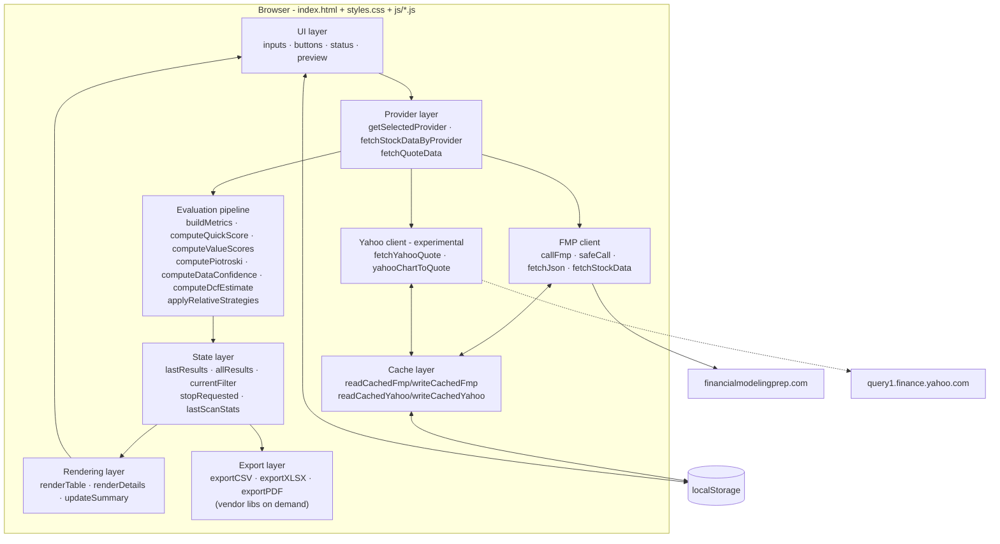
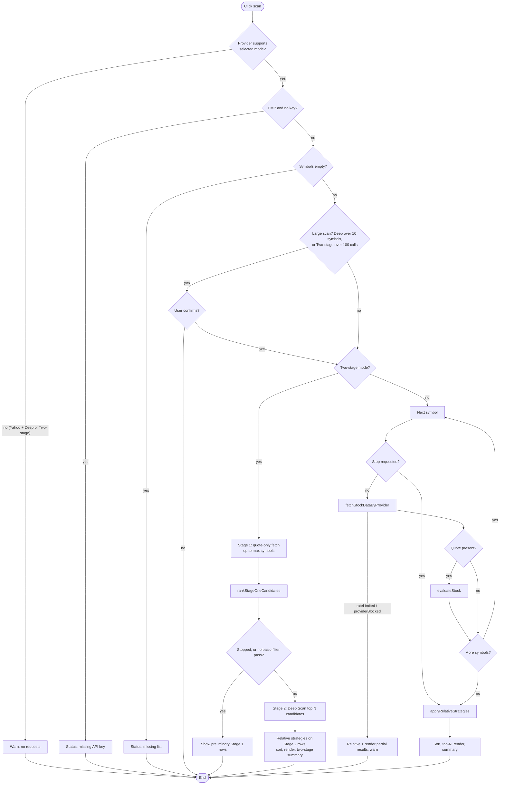

# Architecture

Last updated: 2026-10-12 (after PR #18: four app-shell screens, Results search/sort, legend and empty states)

## 1. Current architecture: static files, no build

The app is a static frontend ([ADR-0004](decisions/ADR-0004-split-static-assets.md), which superseded the single-file [ADR-0001](decisions/ADR-0001-single-file-static-app.md) in PR #8):

| File | Contents |
| --- | --- |
| `index.html` | Markup only: header, the shell nav, and the four screens (Setup, Results, Methodology, Settings & Tools) with their forms, summary, results table (36 columns) and the details dialog. Inline `onclick` / `onchange` / `oninput` handlers call global functions. |
| `styles.css` | CSS variables, card/grid layout, table, pills, responsive breakpoints |
| `js/constants.js` | Presets, FMP endpoints, providers, cache TTLs, scoring/DCF limits, Two-stage settings |
| `js/state.js` | Shared state: `lastResults`, `allResults`, `currentFilter`, `stopRequested`, `lastScanStats` |
| `js/utils.js` | Escaping, parsing, number helpers, formatting, math, input clamping |
| `js/cache.js` | localStorage cache (FMP + Yahoo), Clear Cache |
| `js/providers.js` | Provider selection, FMP client, Yahoo Experimental client, `fetchStockDataByProvider` |
| `js/metrics.js` | `buildMetrics`, derived metrics, Data Confidence |
| `js/dcf.js` | DCF estimate |
| `js/scoring.js` | Strategy scores, Piotroski, Dreman/Neff relative, total score and decision, `evaluateStock` |
| `js/render.js` | Status, request preview, pills, results table view (tabs, search, sort, empty states and notes), details dialog, summary |
| `js/scan.js` | Request planning, `scanStocks`, Two-stage scan, stop, endpoint tests |
| `js/export.js` | Shared export rows plus `exportCSV`, `exportXLSX` and `exportPDF`; loads the `vendor/` libraries on demand |
| `vendor/` | Pinned third-party export libraries (ExcelJS 4.4.0, jsPDF 4.2.1, jsPDF-AutoTable 5.0.8), never loaded at page start. See [vendor/README.md](../vendor/README.md) and [ADR-0006](decisions/ADR-0006-export-dependencies.md). |
| `js/app.js` | `initializePage` and settings handlers. Runs `initializePage()` at load time. |
| `js/shell.js` | App shell (PR #11, [ADR-0005](decisions/ADR-0005-app-shell-navigation-plan.md)): hash routing between screens, the global scan bar, focus and title handling. Loaded last and self-initializing; it only observes the DOM and calls `requestStopScan()`. |

The scripts are **classic scripts loaded with `defer` in the order above**. They share one global scope, so functions in one file can call functions in another at runtime. There is no `package.json`, build step, bundler, transpiler, module system, backend or external (CDN) script.

## 2. Browser-only runtime

The app runs entirely in the user's browser. Network calls go **directly** from the page to the data provider over HTTPS:

- **FMP** returns `Access-Control-Allow-Origin: *`, so browser calls work.
- **Yahoo's** chart endpoint does not send CORS headers, so browsers normally block reading the response. That is why the provider is experimental ([ADR-0002](decisions/ADR-0002-fmp-primary-provider.md)).

## 3. Layers

### UI layer

- **Settings:** provider and API key (FMP, on Settings & Tools since PR #16), preset list, scan mode, top-N, market-cap thresholds (US / non-US), minimum volume, minimum price, Two-stage settings (Stage 1 max symbols, Deep Scan Top N), DCF assumptions, and the symbol textarea.
- **Layout (PR #9):** the settings are grouped sections, each with a title, a white panel and a short helper footer. In order: data source, stocks to check, scan mode, basic filters and DCF assumptions (both native `
`, collapsed by default), then actions (since PR #16 the data source group lives on Settings & Tools). Only the markup and CSS are grouped; all element IDs and inline handlers are unchanged, so the JS is unaware of the layout.
- **Actions:** scan (the primary button) and stop, on Setup. The connection tests (FMP endpoint test, selected-provider test), Clear Cache and Clear API key are on Settings & Tools (PR #16), and the export buttons are on Results (PR #11, PR #12).
- **Feedback:** `#requestPreview` and `#status` (via `setStatus`) on Setup, mirrored on Settings & Tools; `#endpointStatus` and `#providerWarning` (visible only for Yahoo) on Settings & Tools.
- **RTL:** the page is `lang="he" dir="rtl"`. Symbol input and numbers are LTR.

### State layer

These module-level variables live only in memory:

| Variable | Meaning |
| --- | --- |
| `allResults` | All evaluated rows from the last scan, sorted by total score |
| `lastResults` | Top-N slice that is displayed and exported |
| `currentFilter` | Active table tab. The search term and the sort option live in the `#resultsSearch` and `#resultsSort` controls and never change the arrays above. |
| `stopRequested` | Set by the stop button |
| `lastScanStats` | `{ checked, apiCalls, cacheHits, stopped, mode, twoStage? }`. `twoStage` holds the Stage 1 / Stage 2 counters for the summary line. |

These values are persisted in `localStorage`: the API key, the selected provider, and the cache entries.

### Provider layer

| Function | Role |
| --- | --- |
| `PROVIDERS` | `{ fmp: {label, supportsDeep: true, needsApiKey: true}, yahoo: {label, supportsDeep: false, needsApiKey: false} }` |
| `getSelectedProvider()` | Reads `#dataProvider` and falls back to `fmp` |
| `providerLabel(p)` | Display label |
| `fetchQuoteData(p, symbol, key)` | One quote, used by the selected-provider test |
| `fetchStockDataByProvider(symbol, key, mode, p)` | Scan entry point. FMP → `fetchStockData`. Yahoo → quote-only raw record. |

### FMP flow (Current)

1. `fetchStockData` calls `safeCall("/stable/quote")`.
2. In deep mode, it loops over `DEEP_ENDPOINTS` (9 endpoints) with a 70 ms delay between calls.
3. `safeCall` wraps `callFmp`, which checks the cache, builds the URL with `symbol`, `apikey` and the extra params, then calls `fetchJson`.
4. `fetchJson` handles errors:
   - **Rate limits** (HTTP status 429, or limit text in an explicit error field; the body of a successful response is never scanned) throw `rateLimited`, which stops the scan.
   - **Restricted endpoints** throw an error that is recorded as missing data.

### Yahoo experimental flow

1. `fetchStockDataByProvider` throws if the mode is not `quick`. The UI blocks this case even earlier, in `scanStocks`.
2. `fetchYahooQuote` checks the cache, then GETs `v8/finance/chart/{symbol}?interval=1d&range=1y`.
3. Errors:
   - A network/CORS failure, 401 or 403 throws `providerBlocked`, which **stops the scan** so Yahoo isn't called repeatedly.
   - 429 goes through the rate-limit path.
   - Other errors are recorded per symbol.
4. `yahooChartToQuote` maps the response onto FMP quote field names, so `buildMetrics` works unchanged. Market cap is `null`.

### Cache layer

Entries are `{timestamp, data}` JSON in `localStorage`. FMP uses a 10-minute TTL for quotes and 7 days for everything else. Yahoo uses 10 minutes. See [SPEC §15](../SPEC.md#15-cache-behavior).

### Scan / evaluation pipeline

`scanStocks()`:

1. Validate the inputs.
2. Block Yahoo Deep Scan.
3. Require a key for FMP.
4. Confirm large FMP deep scans.
5. For each symbol:
   - Fetch the data.
   - Count API calls and cache hits.
   - Run `evaluateStock` if a quote exists.
6. `applyRelativeStrategies` runs across all rows: relative basis, Dreman, Neff, then the final total and decision.
7. Sort, slice to top-N, render, and update the summary.

In `twoStage` mode, `scanStocks` hands off to `runTwoStageScan()` after the same validation:

1. **Stage 1:**
   - Quick fetch for up to *Stage 1 max symbols*, then `evaluateStock`.
   - `rankStageOneCandidates` orders the rows (candidate ordering only).
2. **Stage 2:**
   - The top N candidates that pass `passBasic` get a deep fetch, reusing the cached Stage 1 quote, then `evaluateStock`.
   - `showTwoStageResults` applies `applyRelativeStrategies` to the Stage 2 rows only, then sorts and renders.
3. **Stop / rate limit:** the scan halts immediately. It shows the partial Stage 2 rows, or the preliminary Stage 1 rows labeled via `scanMeta.stage = 1`.

For Two-stage rows, `renderDetails` and the source column show `scanMeta`, and `#twoStageSummary` shows the stage counters.

### Rendering layer

- `renderTable` builds the 36-column table for the active tab. Since PR #17 it renders `resultsViewRows()`: the tab filter, then the search term (`#resultsSearch`), then an optional sort (`#resultsSort`), on a **copy** of `lastResults`. The stored arrays are never mutated, exports still read `lastResults`, and `detailsRows` is the displayed array, so `openRowDetails(index)` opens the row on screen. The `#` column is the position in the displayed view. Empty views render `resultsEmptyCell()` (no scan, empty tab, no match, no rows), and `resultsStateNoteHtml()` fills `#resultsStateNote` (all rejected, Preliminary only). Rows written by `js/scan.js` for failed scans are unchanged.
- `renderDetails` renders the **פתח פירוט** button for each row. `openRowDetails` fills the details dialog (`detailsDialogBodyHtml`) from the displayed row.
- `updateSummary` fills the 5 summary boxes from `allResults`.
- All dynamic strings pass through `escapeHtml`.

### Export layer

`buildExportRows()` turns `lastResults` (the displayed top-N) into 44 values per row, in `EXPORT_HEADERS` order. Every format uses it:

- **`exportCSV`:** quotes the values and downloads `value_stock_finder_results.csv`. The output is byte-identical to the format before PR #12.
- **`exportXLSX`:** loads `vendor/exceljs-4.4.0/exceljs.min.js` on first use and writes a workbook with three sheets: Summary, Results (the same 44 values) and Notes.
- **`exportPDF`:** loads jsPDF and AutoTable on first use and writes an A4-landscape report with 11 key columns, paginated, with the header repeated on each page.

Feedback goes to `#exportStatus` next to the buttons. Loading is done with injected `<script>` tags, so it still works over `file://` and needs no build step.

### Row details dialog (PR #12)

The last table column renders a **פתח פירוט** (open details) button (`renderDetails(row, index)`).

- `openRowDetails(index)` fills the native `<dialog id="detailsDialog">` from the same row object, using the existing helpers: test lists, DCF details, pills and confidence.
- The dialog is placed outside the screens, so a hidden screen never hides it.
- Escape, the ✕ button, the footer button and a backdrop click all close it. Focus returns to the button that opened it.
- On phones (≤ 650 px) the dialog is full-screen. The body scrolls inside the dialog with contained overscroll.

## 4. Scan flow

## 5. Why there is no backend currently

- The app is a personal tool. A few static files are the simplest thing that works.
- FMP allows browser calls (CORS `*`).
- A backend adds hosting, cost, deployment and maintenance.
- The cost of this choice is that **API keys cannot be hidden**. That is accepted for local personal use and documented in [ADR-0003](decisions/ADR-0003-no-backend-yet.md) and [security.md](security.md).

## 6. Navigation: the app shell

The app is one static page with **four screens**, shown one at a time and chosen by the URL hash ([ADR-0005](decisions/ADR-0005-app-shell-navigation-plan.md)). Each screen is a `
` wrapper toggled with `hidden`, so every element stays in the DOM and every original ID and inline handler is unchanged.

| Screen | Hash | Added | Contains |
| --- | --- | --- | --- |
| Setup (**הגדרת סריקה**) | `#/setup` (default) | PR #11 | Hero and workflow strip, a provider and key summary line, stocks, scan mode, basic filters, DCF assumptions, Scan / Stop, `#requestPreview` and `#status` |
| Results (**תוצאות**) | `#/results` | PR #11 | Summary, Two-stage summary, export buttons, the "how to read" legend, tabs, search and sort, the 36-column table |
| Methodology (**מתודולוגיה**) | `#/methodology` | PR #15 | Static Hebrew explanation of the scan modes, Data Confidence, DCF, the seven strategies, score and limits. Condenses [investment-methodology.md](investment-methodology.md); no scan data, scripts or storage. |
| Settings & Tools (**הגדרות וכלים**) | `#/settings` | PR #16 | Provider select, API key, Yahoo warning, connection tests with `#endpointStatus`, Clear Cache, Clear API key, a mirrored request preview and status, and a note that exports are on Results |

**What `js/shell.js` owns** (loaded last, self-initializing; it only observes the DOM and calls `requestStopScan()`):

- **Routing:** `SHELL_ROUTES` maps `#/setup`, `#/results`, `#/methodology` and `#/settings`. An empty or unknown hash shows Setup. Element hashes (`#sec-scan`, `#methodology-dcf`, `#settings-cache` …) open the screen that contains them, then scroll and focus. `hashchange` drives Back/Forward. The document title and the focused heading follow the screen, and each screen's scroll position is kept in memory.
- **Global scan bar:** a spinner while `#scanButton` is disabled, a mirror of `#status`, a Stop proxy, the final status with a "results ready" link, and a dot on the Results tab. It never navigates automatically.
- **Settings mirrors:** `#shell-settings-status` and `#shell-settings-preview` copy `#status` and `#requestPreview`, and `#shell-source-provider` / `#shell-source-key` give Setup a one-line summary that links to `#settings-provider`.
- **Layout offset:** `--shell-offset` follows the sticky bar's height, so anchors land below it. A compact header is used on every screen except Setup.

**Where the controls moved (PR #16):** the provider select (`#dataProvider`), the API key field (`#apiKey`), the Yahoo warning, the connection tests, Clear Cache and Clear API key moved from Setup to Settings & Tools. Their IDs and handlers did not change, so `app.js`, `scan.js` and `cache.js` run as before. `#sec-source` now sits on the Settings provider section, so workflow step 1 opens Settings. This differs from ADR-0005's plan, which kept API key entry in Setup.

**What `js/render.js` owns for Results:**

- **View:** `renderTable` shows `resultsViewRows()`: the tab filter, then the search term (`#resultsSearch`, symbol or company), then an optional sort (`#resultsSort`), on a **copy** of `lastResults`. The stored arrays are never mutated. Exports read `lastResults`, so they contain all stored results. `detailsRows` is the displayed array, so `openRowDetails(index)` opens the row on screen. The `#` column is the position in the displayed view.
- **Empty states and notes (PR #18):** `resultsEmptyCell()` writes the message for no rows (no scan, empty tab, no search match, no results), with **הצג את הכול** and **נקה חיפוש** actions, and `resultsStateNoteHtml()` fills `#resultsStateNote` (every row rejected, Preliminary only). Messages for scans that fail before any row exist are written by `scan.js`.
- **Details dialog:** `openRowDetails`, `closeRowDetails` and `detailsDialogBodyHtml` fill the native `<dialog id="detailsDialog">`, which sits outside the screens.

The architecture is unchanged: static files, classic scripts, no build step, no backend, no framework. Third-party code is limited to the vendored export libraries loaded on demand ([ADR-0006](decisions/ADR-0006-export-dependencies.md)). The shell and the Methodology and Settings screens use no `localStorage` of their own.

**Still planned:** a sticky Results summary or toolbar, a display-limit note and column-group hints (see [roadmap.md](roadmap.md), M12).

## 7. Future architecture options (not implemented)

| Option | What it would enable | Cost |
| --- | --- | --- |
| ES modules (`type="module"`) instead of classic scripts | Explicit imports and exports, no shared globals | Inline handlers must be replaced; `file://` stops working. Needs a new ADR. (The static-file split itself is done: [ADR-0004](decisions/ADR-0004-split-static-assets.md).) |
| Small serverless proxy (e.g. Cloudflare Worker, Netlify Function) | Hide the FMP key, add CORS for other providers, server-side caching | Hosting, secrets management, abuse protection |
| Background / batch scanner | Market-wide universes, scheduled screens (the browser-side Two-stage scan already exists) | Needs storage and a backend |
| Provider plugin interface | Cleaner multi-provider support (TASE, global) | Refactor of the provider layer |
| Automated tests (headless browser or extracted pure functions) | Regression safety for scoring | Tooling. Must not add runtime dependencies. |

Any of these requires explicit user approval and a new ADR.
